# CS224R Lecture 1 — Class Intro 笔记

> 斯坦福 CS224R 深度强化学习（Chelsea Finn）
> 字幕来自 2025 Spring 录播，讲义为 `讲义/01_cs224r_intro_2026.pdf`（2026 版，共 53 页）。
> 两版内容基本一致，个别差异在文中标注。括号内时间为录播时间点，`Slide N` 为讲义页码。

---

## 一、马尔可夫性质与部分可观测（22:15–26:57 / Slide 33–36）

### 1.1 先把经验写成数据

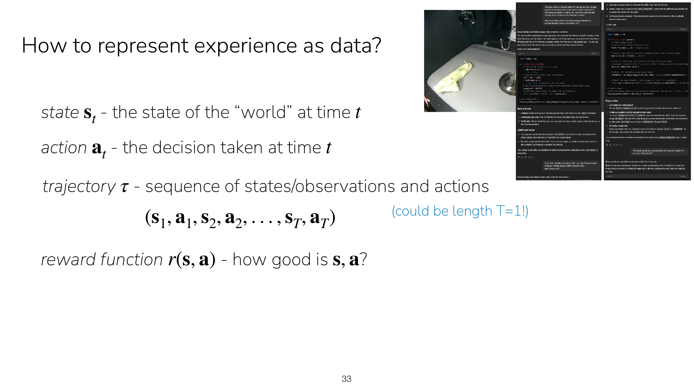

RL 把经验记成四样东西：状态 `sₜ`、动作 `aₜ`、轨迹 `τ = (s₁,a₁,…,s_T,a_T)`、
奖励函数 `r(s,a)`。讲义特地标了一句 **"could be length T=1!"**——轨迹长度可以是 1，
也就是单步决策（老虎机问题）本身就是 RL 的一个特例。

### 1.2 状态满足马尔可夫性质

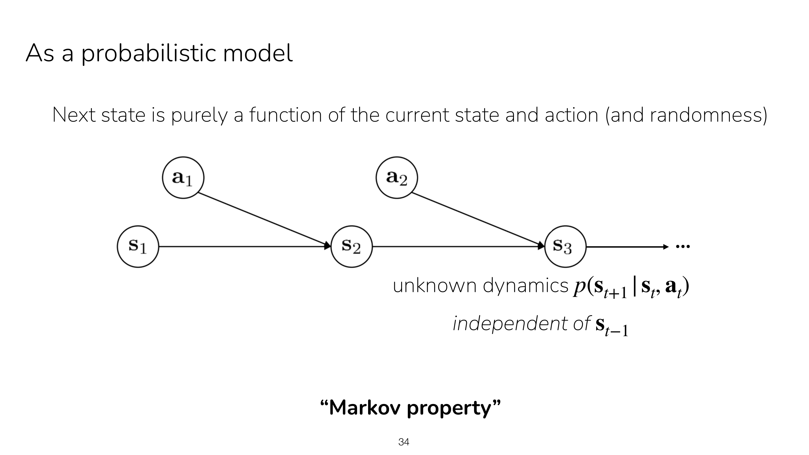

动态写成 `p(s_{t+1} | sₜ, aₜ)`——右边**只有当前状态和当前动作**，与 `s_{t-1}` 及更早的
一切无关，讲义上直接写明 *independent of s_{t−1}*。图上也看得很清楚：
**没有任何一条箭头跨过中间的状态**，s₁ 只能通过 s₂ 影响 s₃。

为什么这条性质这么重要：

- 策略可以写成 `π(a|s)`——只吃当前状态一个输入，不用吃整条历史
- `V(s)`、`Q(s,a)` 才有良定义（否则"状态的价值"会依赖于你怎么走到这儿的）
- 贝尔曼方程、价值迭代、Q-learning、策略梯度，全部建立在这条性质上

一句话：**马尔可夫性是把一个无限长的序贯决策问题"切成一个个独立小片"的那把刀。**
她的说法是，有了它就可以把问题分解，而不必担心之前的所有依赖关系。

### 1.3 拿不到状态怎么办：讲义给了两个选项

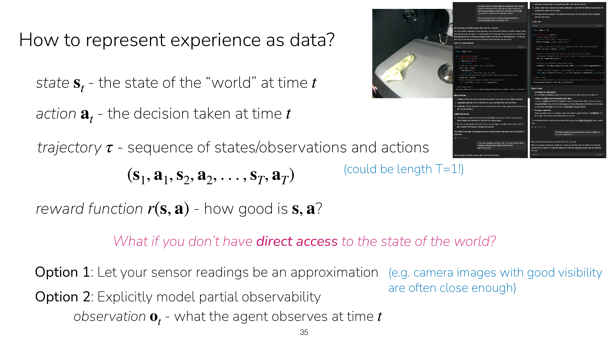

这一页在 Slide 33 的基础上追加了一个问题：**如果你没有世界状态的直接访问权呢？**
讲义明确给了两条路，这个二选一在录播里是零散讲的，讲义归纳得更清楚：

- **Option 1：拿传感器读数当近似。** 讲义的原话是"能见度好的相机图像通常就足够接近了"
- **Option 2：显式建模部分可观测性**，引入观察 `oₜ`

这正对应她在课上回答学生时说的那套成本权衡：**能当状态用就当状态用，因为便宜太多**。

### 1.4 换成观察，马尔可夫性就坏掉了

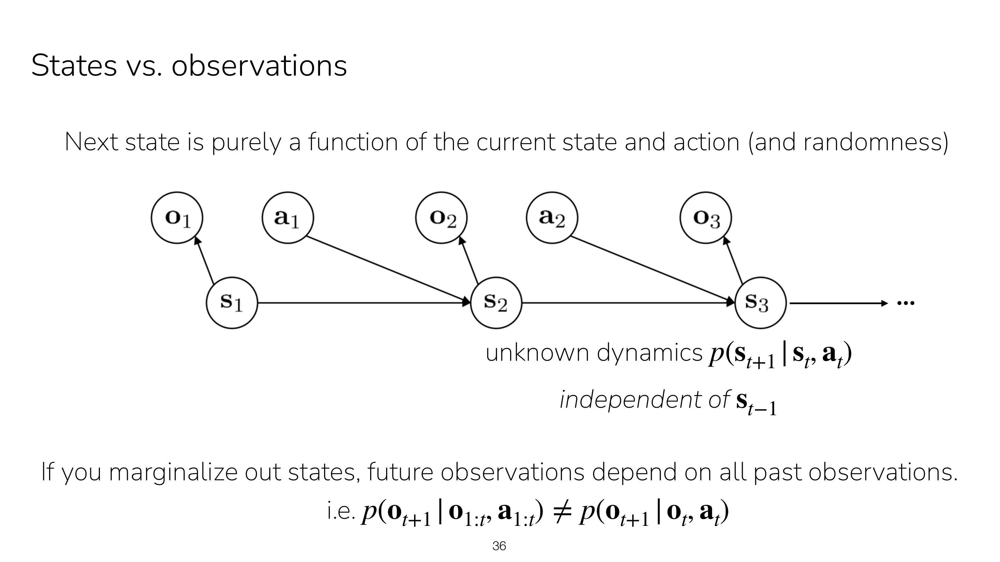

这一页是整段的论点页。和 Slide 34 相比只多了一行 `o₁ o₂ o₃`，
每个 `oₜ` 由 `sₜ` 发出一条箭头——**观察是状态的函数，且会丢信息**。
讲义底下那行是结论的形式化：

```
如果把状态边缘化掉，未来的观察依赖于全部过去的观察：
    p(o_{t+1} | o_{1:t}, a_{1:t})  ≠  p(o_{t+1} | oₜ, aₜ)
```

**为什么蒙住 s 就冒出了 o₁ → o₃ 的依赖？** 因为 o₁ 和 o₂ **各自携带一部分关于 s₂ 的
信息**：只拿 o₂，对 s₂ 的了解残缺，对 o₃ 的预测就差；补上 o₁，了解更完整，预测更准。
用图模型的话说，就是把隐变量边缘化之后，原本被 s 阻断（d-separate）的路径被打开了
（24:23 她顺口提了这个视角，说今天不深入）。

### 1.5 接触/触觉例子 —— 为什么历史观察不可丢

这段讲义上没有，是课堂问答，但它是整段最关键的论证。起因是一个学生追问（25:29）：
**既然观察只是状态的一部分，凭什么说最近那一帧不够用？**

她用触觉传感器给了一个反例：接触 → 脱离接触 → 再接触。

| 时刻 | 发生了什么 | 触觉读数 | 信息量 |
|---|---|---|---|
| t=1 | 手指碰到杯子 | 有压力、有接触位置 | **高**，此刻知道杯子在哪 |
| t=2 | 手抬起，脱离接触 | 全 0 | **≈ 0**，什么也推断不出 |
| t=3 | 要再去抓 | — | 该往哪伸？ |

在 t=3 做决策时，最近的 o₂ 是一片空白、毫无用处，真正有用的信息藏在更早的 o₁ 里，
所以同时以 o₁ 和 o₂ 为条件才能对 o₃ 知道得更多（26:08）。
**这个例子反驳的是"最近的观察总是最有用"这个直觉**：部分可观测下信息的时效性是
不规则的，关键信息可能只出现在很早的某一帧，之后一直是噪声或空白，所以不能像
马尔可夫情形那样安全地丢掉历史。

她还补了一句（24:07）：**需要多少历史，高度依赖领域和传感器**——许多机器人任务
当前一帧就够；触觉信息量远少于视觉，没接触上时一无所知；加上摄像头图像就完整得多，
所以**换/加更好的传感器本身也是一种解法**（这就是 Slide 35 的 Option 1）。

### 1.6 结论：POMDP

形式上就是 `oₜ = f(sₜ)` 而 `sₜ` 不可见（26:38），这就是 **POMDP**（部分可观测马尔可夫
决策过程）；状态可观测才是 **MDP**。这两个名字要到本讲 52:23 的总结才正式点出。

工程上要让策略重新"马尔可夫化"，有四条路：堆叠最近 k 帧观察（Atari DQN 堆 4 帧，
L17 @27:51 还会讨论堆几步）、给策略加记忆用 RNN/Transformer 压缩历史（@35:33，
也写在 Slide 39 上）、加传感器让 o 逼近 s（@24:29）、以及把你已知的状态量
（关节角、速度、物体位姿）直接手工喂进去，别让网络从像素自己学（@38:13）。

---

## 二、把符号落到真实系统：状态/动作/时间步怎么定（26:57–31:46 / Slide 37–38）

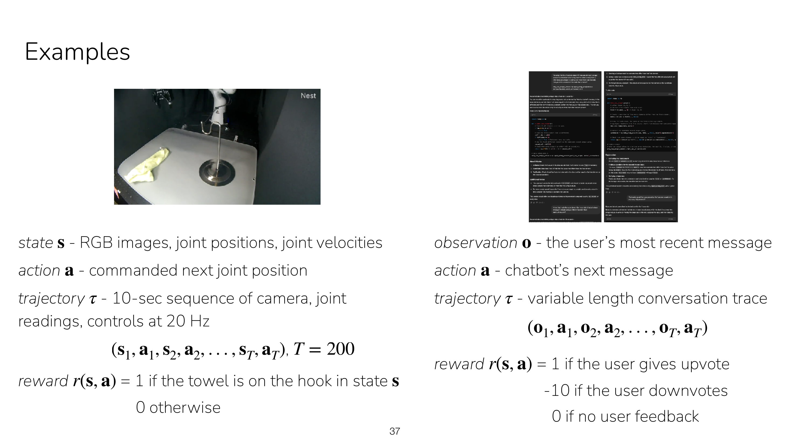

讲义把两个反差极大的例子并排放在一页，用意很明显：**同一套框架套在不同问题上长什么样**。

**左边，机器人**：状态 = RGB 图像 + 关节位置 + 关节速度；动作 = **指令关节位置**
（当前 90°，命令它去 92°）；轨迹 = 20 Hz 下 10 秒的相机、关节读数和控制指令，
**T = 200**；奖励 = 毛巾在钩子上为 1，否则 0（录播里她还提到外加扭矩惩罚）。

三个值得注意的点：

- **状态是异构拼接的**。图像是几万维张量，关节位置是七八维向量，她特地提醒要配置网络
  来接受不同维度的输入——实践中就是 CNN 编码图像、MLP 编码本体感知，再拼特征。
- **为什么要放关节速度**。只有位置无法预测下一刻会在哪（同一位置，手臂往左挥还是往右挥，
  未来完全不同），位置 + 速度才构成满足马尔可夫性的完整状态。这是上一节内容的直接应用。
- **动作是目标位置而非力矩**，即位置控制，底下还有低层 PD 控制器负责执行，
  策略不必操心动力学。这让动作空间更平滑、更好学，是机器人 RL 的常见选择。

**20 Hz 这个反直觉的点**：时间被离散化成 1/20 秒，每秒 20 帧图像、20 次关节观测、
20 次指令。她说自己初次接触时觉得很反直觉——人不会每秒思考 20 次该怎么做——
但这是表示物理系统上数据与行为最实用的方式。它暴露了一个张力：
**RL 的时间步由物理采样率决定，不由任务语义决定**。"把毛巾挂上钩子"在 20 Hz 下
就是上千步（讲义上 10 秒 = 200 步），于是立刻撞上长时域信用分配问题——
这正是后面 L15 分层 RL 存在的理由。

**右边，聊天机器人**：观察 = 用户最近一条消息（注意讲义这边**用的是 o 不是 s**，
因为没有紧凑的状态表示）；动作 = 发出的下一条消息，可能是一整段、非常大；
轨迹 = **variable length** 的对话记录；奖励 = 点赞 +1、点踩 −10、无反馈 0。

对照出来的结论是**时间步是你自己定义的抽象单位，不是物理秒**：机器人一步 = 1/20 秒，
均匀、由物理决定；对话一步 = 用户下次响应的间隔，不均匀、由事件决定。只要满足
"观察 → 动作 → 新观察"这个循环，什么都能当一步。另外两点：动作空间可以极大
（一整段文本 vs 机器人的 7 维向量，这预告了 LLM 的 RL 要把生成拆成逐 token 的动作）；
奖励 +1/−10 的不对称是人为设定的风险厌恶，说明**奖励函数是设计出来的、带着价值判断**。

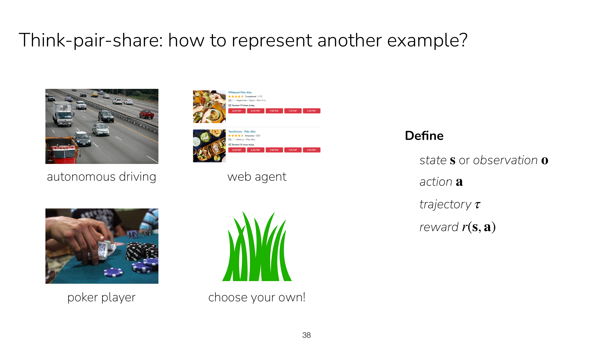

然后是一页 **think-pair-share**：让学生自己为自动驾驶、web agent、扑克玩家
或自选例子定义 s/o、a、τ、r。讨论后的三个提问恰好覆盖三个经典坑：

**坑一，自动驾驶算 MDP 还是 POMDP？** 她的回答是两种都有可能，取决于传感器细节。
若只有激光雷达深度 + 前向图像，缺的是**周围车辆的速度**——一辆车静止还是以 60 英里/小时
行驶，对未来预测完全不同。补法是把 LiDAR 的历史加进来，比如用 3 秒历史作为状态。
她说这代表了处理观察的一个通用主题：**用一段历史来构建状态表示**。
注意这跟"关节位置 + 关节速度"是同一件事的两种做法——要么直接测速度，
要么用位置历史把速度推出来。她的态度是"关键就在于细节"：
**MDP 还是 POMDP 不是题目给你的，是你根据传感器配置自己判断的**。

**坑二，稀疏奖励怎么学？** 学生问：奖励是挂上钩子才给 1，如果机器人从没成功过，
不就永远没有信号？她答：那段视频里他们**先给机器人演示了几次**，演示帮助它完成
所谓的**探索**；当奖励非常稀疏、信号很弱、与目标关联不紧密时，这种演示数据对
**启动**整个 RL 问题往往是关键的。这同时预告了 L2 模仿学习和 L14 探索，
也解释了"演示初始化 + RL 微调"为何是机器人领域的标准配方。

**坑三，传感器有噪声，是不是一切都只能算观察？** 她分三层回答：理论上是的，
担心噪声就可以把任何东西建模成观察；但代价很大，若因此要塞入大量历史，
内存和计算开销很重（35:33 补充：给策略加记忆会吃掉大量 GPU 显存，纯状态输入
则不需要任何记忆，"非常方便"）；所以实践中会近似——哪怕某个量技术上属于观察，
只要信息损失很小（例如每 10000 次才坏一次、图像偶尔全黑），就当状态用。
一句话：**MDP vs POMDP 在工程上是成本收益权衡，不是真假判断**，能当 MDP 就当 MDP。
这正是 Slide 35 那两个 Option 的实践含义。顺带还有一问"观察用绝对值还是增量"，
答案同样是权衡：要塞大量历史时，用增量做压缩才划算。

---

## 三、从要素到可优化的目标，以及算法谱系（33:46–52:45 / Slide 39–45）

### 3.1 策略的表示

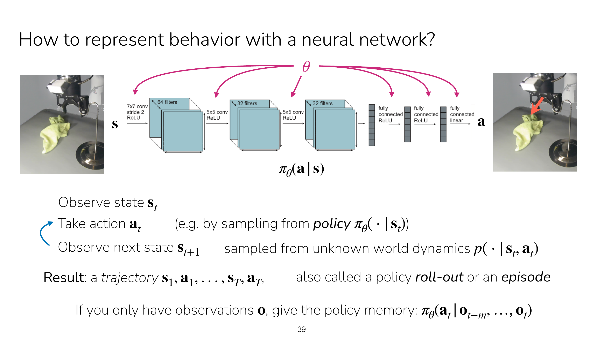

π 就是从状态/观察到动作的映射，实现上可以是 CNN、Transformer、全连接网络甚至线性函数，
参数记作 θ。讲义把执行流程写成三行：**观察 sₜ → 采取 aₜ（从 `πθ(·|sₜ)` 采样）→
观察 s_{t+1}（从未知世界动态 `p(·|sₜ,aₜ)` 采样）**。

她强调"**采样**"这个词——动作不是网络输出的确定值，而是从网络定义的分布里抽出来的，
这为后面"策略为什么要随机"埋了伏笔。跑完一整条轨迹叫 **roll-out** 或**一个回合
（episode）**；rollout 这个词的来历是沿着动力学把策略一步步推进下去，从而产出轨迹。

讲义最后一行直接给出了部分可观测的解法：
**`πθ(aₜ | o_{t−m}, …, oₜ)`——只有观察时，就给策略记忆。** 这正是第一节的收尾。

**关于记忆的工程代价**（35:29–38:28，讲义上没有）：只有状态时策略不需要任何记忆，
她说这"非常方便"，因为记忆会占用大量 GPU 显存。有学生问"既给状态又给观察有用吗"，
她答得很干脆：**没用**——如果状态真的捕捉了全部信息，再加观察是冗余的。这其实给出了
状态的操作性定义：**状态就是那个"加了历史也没有额外收益"的东西**。她用语言模型举例
说明历史为何有用：用户先问"能帮我写这段代码吗"，你写了，他给了反馈，只有把所有过去
观察都纳入才能捕捉世界的完整状态。进阶做法是**两阶段**：先从观察历史推断状态，
再基于推断出的状态预测动作。（符号约定：大写 T = 轨迹长度，小写 t = 某个时间步。）

### 3.2 目标为什么必须写成期望

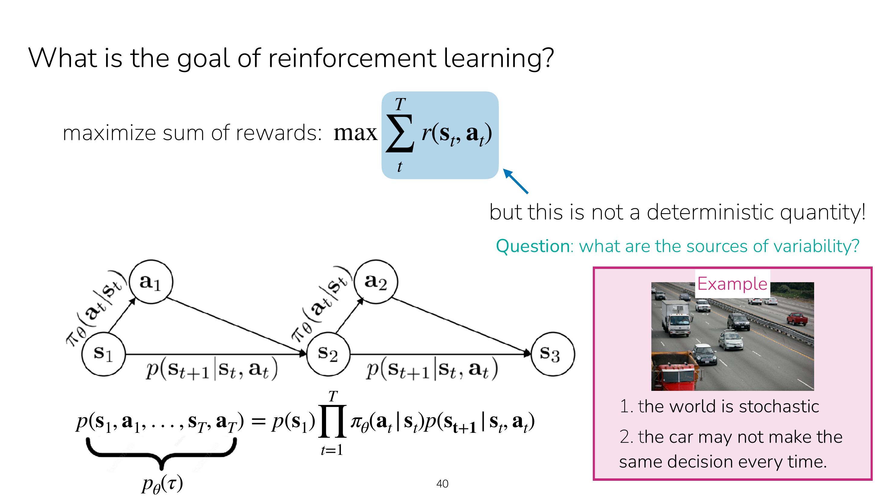

朴素目标是 `max Σₜ r(sₜ,aₜ)`，但讲义右上角立刻加了一句
**"but this is not a deterministic quantity!"**，并把"随机性来源是什么"作为课堂提问。
讲义右侧给出的两条答案就是录播里师生一起收敛出来的：

1. **the world is stochastic** —— `p(s'|s,a)` 是分布而非确定性函数（开车时其他车辆的行为随机）
2. **the car may not make the same decision every time** —— 策略本身是随机的

左下角同时给出了轨迹概率的分解式：

```
p(s₁,a₁,…,s_T,a_T) = p(s₁) · Π_{t=1..T} πθ(aₜ|sₜ) · p(s_{t+1}|sₜ,aₜ)
       └ pθ(τ) ┘      └初始状态┘   └──策略──┘      └──动态──┘
```

初始状态也是随机的（她的例子：打牌时发牌方式每次不同）。

课堂上还有两个有价值的追问：**奖励函数会不会也随机？**——通常仍建模为确定性 `r(s,a)`，
随机性归到 s 和 a 身上，但**如果你只有观察而不知道状态，奖励看上去就是随机的**
（随机性的表观来源取决于你能看到什么）。**目标随时间改变怎么办？**——
**不要把随机性塞进奖励函数，把它塞进状态**，比如让一个观察不到的"潜在目标"成为状态的
一部分，奖励就仍是确定性的；她说不失一般性地总可以这样推进状态里。这个技巧在 RL 里
反复出现：**用扩充状态空间消化掉非平稳性和隐藏变量，从而保住 MDP 这个干净框架**。

### 3.3 RL 的目标函数，以及它为什么难

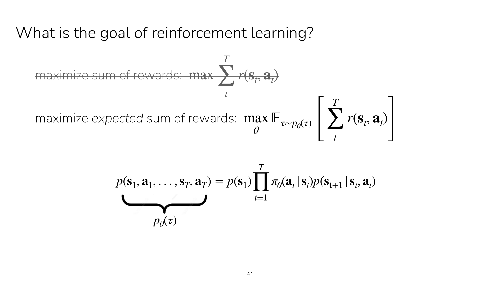

讲义把两行并排摆出来，对比一目了然：上面是朴素求和，下面是真正的目标——

```
max_θ  E_{τ ~ pθ(τ)} [ Σₜ r(sₜ, aₜ) ]
```

**这里是整门课最重要的结构性观察**（44:46）：与监督学习不同，**π 甚至没出现在这个
求和式里**，它起作用的方式是——**轨迹的分布 `pθ(τ)` 是 π 的函数**。讲义用"把 `pθ(τ)`
标注在分解式下方"把这件事画了出来。

这正是 RL 之所以难的根本原因：监督学习的损失里直接有 θ，求导就完了，所以只需要
梯度下降一种算法；RL 里 θ 只通过**改变数据分布**来影响目标，不能朴素求导，于是衍生出
策略梯度（用 log-derivative trick 绕过去）、基于价值（不碰分布，改去估计 Q）、
基于模型（把分布显式建出来）这一整个算法谱系。后面整门课基本都在回答：
在这个目标下怎么优化行为。（顺带：T 不必固定，讲义 Slide 33 也标了"could be T=1"。）

> **两版差异**：2025 录播在这里（45:39–47:08）额外讲了**折扣因子 γ**——
> 若 T = 1000 年，你不会太关心 1000 年后的回报，于是加权成 `E[Σ γᵗ r]`，`0 < γ ≤ 1`，
> γ=1 退化回原式，**γ 越小越"贪婪"**。**2026 版讲义里没有这一页**。
> 值得补充的是 γ<1 还有数学必要性：保证无限时域回报有界、保证贝尔曼算子是压缩映射
> （这是 CS234 L2 的重点）。

### 3.4 策略为什么要是随机的

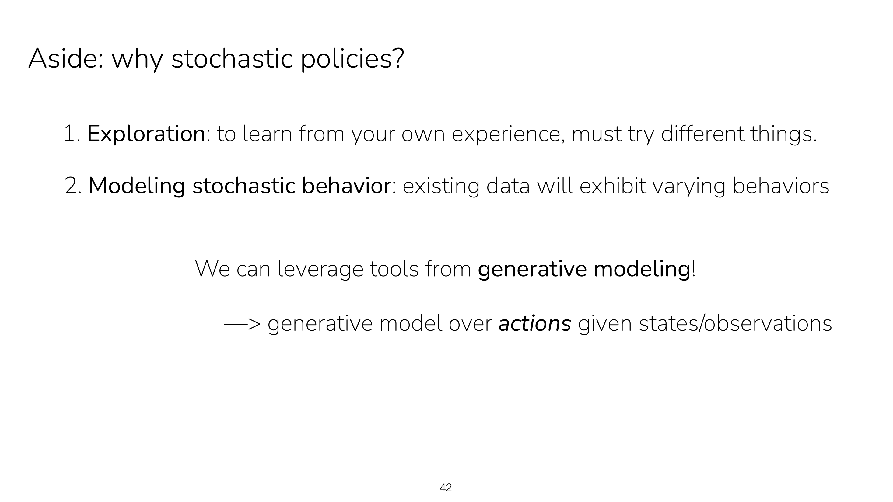

讲义列了两条，和录播完全对应：

1. **Exploration** —— 要从自己的经验中学习，就必须尝试不同的东西。她的例子是学打网球，
   不能一遍遍只试同一种打法。
2. **Modeling stochastic behavior** —— 已有数据会表现出多样的行为。不同的人做法不同，
   确定性策略根本无法表示"有人这样做、有人那样做"这个事实。

讲义底下那行是重要伏笔：**"We can leverage tools from generative modeling!
—> generative model over actions given states/observations"**——
不要只把策略想成从 A 到 B 的神经网络，而是一个以状态/观察为条件的**动作生成模型**。
扩散策略、流匹配策略这些机器人领域的主流做法正是如此，L2 会从多模态动作分布展开。

### 3.5 怎么衡量策略好坏：V 和 Q

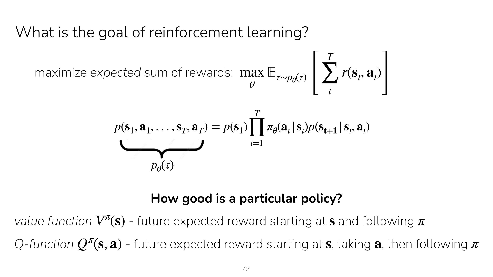

动机很实在（48:25）：**不知道策略有多好，就无法改进它**。讲义的两行定义：

- `V^π(s)` —— 从 **s** 出发、此后一直 follow π 的期望未来回报
- `Q^π(s,a)` —— 从 **s** 出发、**先执行 a**，之后才 follow π 的期望未来回报

关键差异就在那个 **"taking a"**：这个 a **可以不是 π 会选的动作**。
正因为第一步动作自由，Q 才能用来做策略改进——你可以比较不同的 a 并挑最好的，
而 V 做不到。她今天只做介绍，Q 从下周起正式讲。

### 3.6 算法家族分类 —— 整门课的路线图

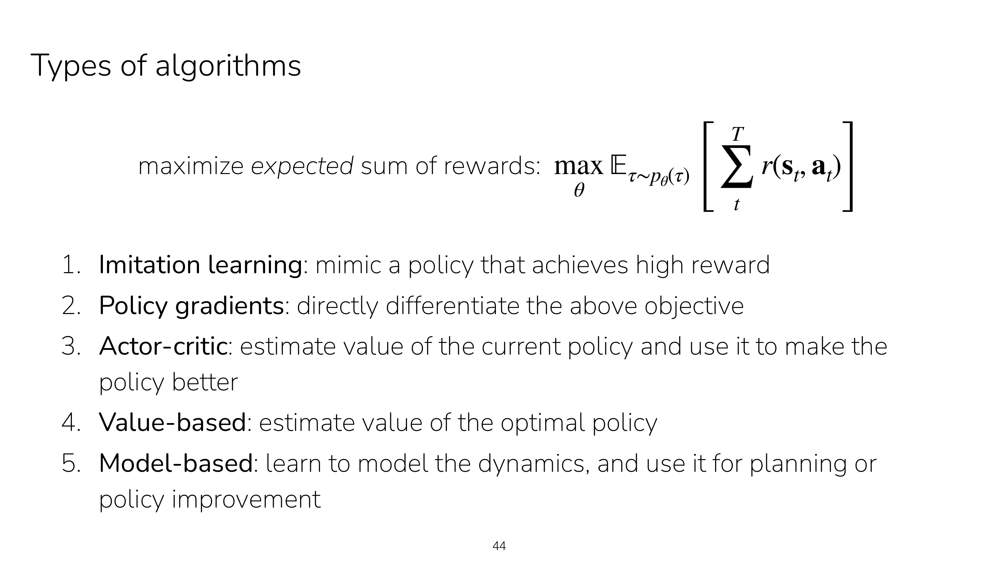

讲义把目标函数放在页顶，下面挂五个家族，意思是**它们都是在优化同一个目标，
只是路径不同**：

| 家族 | 核心思想 | 课程位置 |
|---|---|---|
| 1. 模仿学习 | 模仿一个能拿到高回报的策略 | L2 |
| 2. 策略梯度 | **直接对上面这个目标求导** | L3 |
| 3. Actor-Critic | 估计**当前策略**的价值，用它来改进策略 | L4–L5 |
| 4. 基于价值 | 估计**最优策略**的价值 | L6 |
| 5. 基于模型 | 学动态模型，用于规划或策略改进 | L11 |

Actor-Critic 与基于价值的区别讲义写得很精准：前者是 *value of the **current** policy*，
后者是 *value of the **optimal** policy*，正好对应 on-policy 评估 vs 贝尔曼最优方程。

### 3.7 为什么需要这么多算法

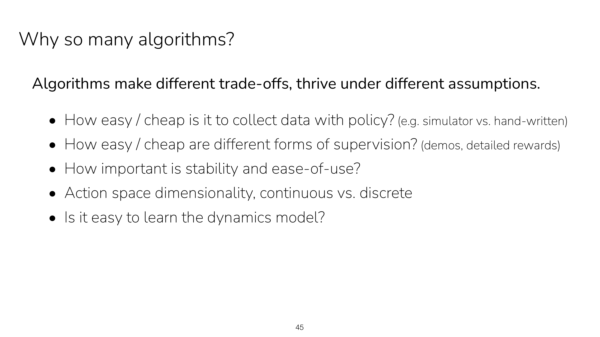

她的反问是：监督学习只需要梯度下降一种算法，又好用又简单，为什么 RL 这么乱？
讲义的答案是一句话加五个 bullet：**不同算法做不同权衡、在不同假设下表现良好**。

| 维度 | 具体问题 |
|---|---|
| 数据成本 | 用策略收集数据有多容易/便宜？（模拟器 vs 手写） |
| 监督形式 | 不同形式的监督有多便宜？（演示、详细奖励） |
| 稳定性与易用性 | 有多重要？（不需要海量数据时，就有更多时间调超参数） |
| 动作空间 | 维度多高？连续还是离散？ |
| 动力学可学性 | 动态模型好不好学？（决定基于模型方法是否可行） |

**这张表是整门课的选型指南**，后面每讲新算法都会回到这几条来定位它。
这也是 CS224R 区别于 CS234 的地方：它关心"什么时候用哪个"，而非"这个算法能不能收敛"。

### 3.8 本讲总结

状态 s、观察 o、动作 a、奖励函数 r、初始状态分布、动态——这六样合起来就是 **MDP**；
只有观察则是 **POMDP**。她自嘲本来不想在最后才引入这个术语，"因为它叫什么其实并不重要"，
但很有用：以后别人说 MDP，你就知道指的是这套问题表述。今天简要过了一遍的其余概念：
轨迹、策略、RL 的目标、价值函数、Q 函数。

> **两版差异**：2026 版讲义在 Slide 46 之后**直接接上了模仿学习**
> （goal of imitation learning、version 0 的 ℓ2 回归、"what could go wrong"），
> 而 2025 录播的 L1 到总结就结束了，模仿学习放在 L2。
> 这说明 2026 版把 L1/L2 的分界往后挪了。

---

## 逻辑骨架

```
状态 s 满足马尔可夫性                                      [Slide 34]
        │
        ├─▶ 策略只需 π(a|s)，V/Q 有良定义，贝尔曼方程成立 ✔ RL 算法的地基
        │
        ▼
但现实中 s 往往拿不到，只有 o = f(s)，且 o 丢信息          [Slide 35]
        │
        ▼
边缘化掉 s 之后 p(o'|o₁:t,a₁:t) ≠ p(o'|oₜ,aₜ)             [Slide 36]
        │   【接触例子】o₂(脱离接触,全0)无用，o₁(接触中)才有用
        ▼
这就是 POMDP ⇒ 必须把"历史"重新塞回策略输入 πθ(a|o_{t−m..t}) [Slide 39]
        │
        ▼
把要素落到真实系统：20 Hz 机器人 vs 事件驱动的对话          [Slide 37–38]
        │
        ▼
目标 = 整条轨迹的奖励和 …… 但它是随机的                    [Slide 40]
        │   两个来源：环境动态随机 + 策略随机
        ▼
所以目标必须写成期望：max_θ E_{τ~pθ(τ)}[ Σ r ]             [Slide 41]
        │
        ├─▶ 【关键】π 不在求和式里，只通过改变轨迹分布起作用
        │        ⇒ 不能像监督学习那样直接求导
        │        ⇒ 这就是 RL 需要一整个算法谱系的原因
        │
        ├─▶ （2025 录播补充）加 γᵗ 折扣：不想等 1000 年后的回报
        │
        ├─▶ π 要随机：① 探索 ② 拟合多样的人类数据            [Slide 42]
        │        ⇒ 可当生成模型来建（扩散策略的伏笔）
        │
        ▼
怎么知道 π 好不好？ V^π(s) 与 Q^π(s,a)（Q 的第一步动作自由） [Slide 43]
        │
        ▼
五大算法家族：模仿 → 策略梯度 → Actor-Critic → 基于价值 → 基于模型  [Slide 44]
        │
        ▼
为什么这么多？权衡：数据成本、监督形式、稳定性、动作空间、动力学可学性 [Slide 45]
```
