# CS224R Lecture 2 — Imitation Learning 笔记

> 斯坦福 CS224R 深度强化学习（Chelsea Finn）
> 字幕来自 2025 Spring 录播（全长 1:06:56），讲义为 `讲义/02_cs224r_imitation_2026.pdf`（2026 版，共 32 页）。
> 括号内时间为录播时间点，`Slide N` 为讲义页码。两版差异在文中标注。

---

## 这一讲的骨架

L2 的结构很清爽：**一个算法 + 它的两个毛病 + 各自的解法**。

```
模仿学习 = 对专家数据做监督学习（行为克隆 BC）
        │
        ├── 毛病 1：专家行为是多峰的，L2 回归学出平均值 → 灾难
        │        解法：换表达性分布（GMM / 离散化+自回归 / 扩散）   [07:25–51:28]
        │
        └── 毛病 2：复合误差 / 协变量偏移（IL 区别于监督学习的根本）
                 解法：收集纠正性数据（DAgger / HG-DAgger）        [55:00–1:06:56]
```

讲义 Slide 5 的三条"学习目标"正好对应：**怎么用神经网络表示分布**、
**为什么表达性分布对 IL 重要**、**什么是复合误差以及怎么处理**。

---

## 一、行为克隆，以及"L2 回归为什么取平均值"

### 1.1 version 0：最朴素的做法

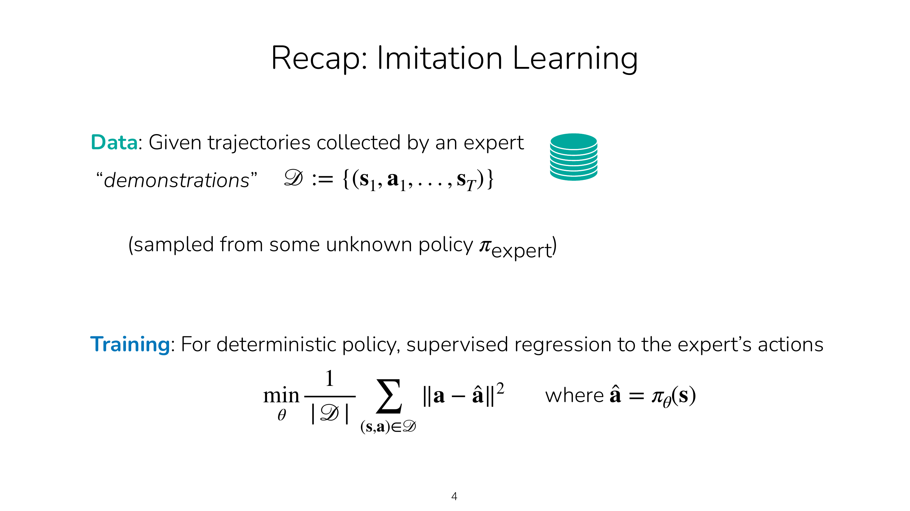

给定专家轨迹数据集 D = {(s,a)}，对确定性策略做**监督回归**：

```
min_θ   (1/|D|) · Σ_{(s,a)∈D}  ‖a − π_θ(s)‖²
```

她明说"**这本质上就是监督学习**"（06:46）、"**我们在做 L2 回归**"（07:06）。
这就是后面 40 分钟要打的靶子。

### 1.2 会出什么问题：多峰性

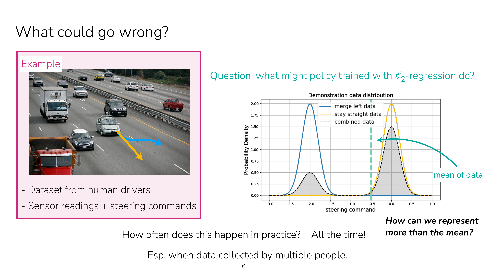

讲义这一页直接把问题摆出来：**用 ℓ2 回归训练出的策略会做什么？—— mean of data。**
右下角还有一行回答常见疑问：**"实践中这种情况多久发生一次？——All the time!
尤其是多人采集的数据。"**

自动驾驶的例子（09:28 左右）：同一个状态下，有些司机**直行**，有些司机**向左并线**。

| 专家人群 | 占比 | 转向指令 |
|---|---|---|
| 直行 | 50% | `0` |
| 向左并线 | 50% | `−2` |

L2 回归的最优输出是 `0.5 × 0 + 0.5 × (−2) = −1`：
不是直行（0），也不是并线（−2），而是**轻微左打方向、沿着车道线压过去**。

她在 10:26 强调的那句是关键：**这个动作在数据分布下的概率极低**——
也就是说 `−1` 在整个专家数据集里可能一次都没出现过。
**L2 回归不仅选了个坏动作，它选了个数据里不存在的动作。**

她在 10:48–11:36 画的三条曲线就是这件事：

```
       绿色：直行人群的动作分布        蓝色：并线人群的动作分布
            ╱╲                              ╱╲
           ╱  ╲                            ╱  ╲
  ────────╱────╲──────────────────────────╱────╲────────▶ 转向指令
         -2.3  -1.7                      -0.3   0.3

       红色：数据集里实际的分布 = 绿 + 蓝
            ╱╲          ← 缺口 →          ╱╲
           ╱  ╲                          ╱  ╲
  ────────╱────╲────────────────────────╱────╲──────────▶
                        ↑
                      均值 = -1
                  L2 回归输出在这里
                  这里的数据密度 ≈ 0
```

### 1.3 ★ 为什么 L2 回归给出的一定是平均值

课上没有推，但这是理解整讲的前提。把问题剥到最简：**固定一个状态 s**，
专家在这个 s 下的动作有好几种可能，而网络只能输出一个数 `â`。损失是

```
L(â) = E[ (a − â)² ]          a 服从专家在 s 下的动作分布
```

对 `â` 求导：

```
dL/dâ = E[ −2 (a − â) ] = −2 ( E[a] − â )
```

令它等于 0：

```
E[a] − â = 0

  ⇒   â* = E[a | s]        ← 最优输出就是条件期望，也就是平均值
```

**平方损失的最优解就是条件期望。** 这不是神经网络的性质，也不是优化器的性质，
而是**平方损失这个函数本身的性质**——它是开口向上的抛物线，顶点正好落在均值处。

**直观版**：把 `(a − â)²` 想成"弹簧的能量"。每个专家动作在数轴上拴一根弹簧连到 `â`，
能量正比于拉伸量的**平方**。所有弹簧一起拉，平衡点落在**所有点的重心**。
平方损失 = 物理上的重心问题。

（顺带：换成 L1 损失 `|a − â|`，最优解变成**中位数**。但中位数在双峰数据上同样落在谷里，
所以换 L1 救不了这个病。）

### 1.4 ★★ 更深一层：L2 回归其实偷偷假设了高斯

这一点她到 47:30 才点明，但提前知道会让后面好懂非常多。

假设策略是**固定方差的高斯**，均值由网络给出：

```
                  1              (a − μ(s))²
π(a|s) = ───────────────── · exp( − ─────────── )
          sqrt(2π σ²)                  2σ²
```

取负对数：

```
                  (a − μ(s))²
−log π(a|s) = ─────────────── + log sqrt(2π σ²)
                    2σ²
              └──────┬──────┘   └──────┬──────┘
             这就是 L2 损失        与 θ 无关的常数
```

于是：

```
最小化 L2 损失   ≡   在「固定方差高斯」这个分布类下做极大似然
```

**病根被定位了**：不是"回归"不好，不是网络不够大，而是
**你悄悄假设了专家动作服从单峰高斯**。高斯只有一个峰，它被迫把峰放在数据的重心上。

既然病根是分布类选错了，药方自然就是换分布类——这就是接下来 30 分钟的全部内容。

---

## 二、表达性策略分布（14:34–45:10 / Slide 7–15）

### 2.1 核心框架：让网络输出"分布的参数"

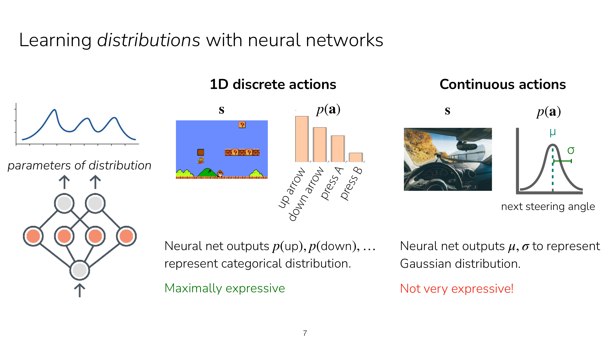

这 30 分钟只有**一个框架 + 四个填空**。框架是 14:34–16:09 讲的（她专门开了块新白板），
讲义 Slide 7 画的就是它：

```
                    ┌──────────────────────────────┐
     状态 s ──────▶ │   神经网络 f_θ （一个盒子）    │ ──────▶ 一组参数 λ
                    └──────────────────────────────┘
                                                            │
                                                            ▼
                                            ┌────────────────────────────┐
                                            │  由 λ 定义的概率分布 p_λ(a) │
                                            └────────────────────────────┘
                                                            │ 采样
                                                            ▼
                                                         动作 a
```

**全部的戏都在最后那个框里——"用什么分布"。网络那个盒子从头到尾没变过。**

她在 15:16 说的那句话是这个框架的钥匙：
**确定性策略只输出均值，所以它根本算不上一个分布。**

讲义 Slide 7 并排给了两个最基础的例子，而且下了判断：

- **1D 离散动作** → 网络输出 `p(up), p(down), …`，是**分类分布**，评语是 **"Maximally expressive"**
- **连续动作** → 网络输出 `μ, σ`，是**高斯**，评语是 **"Not very expressive!"**

汇总成一张表：

| 方案 | 网络输出的参数 λ | 分布 p_λ(a) 是什么 | 能表示多峰吗 |
|---|---|---|---|
| 确定性 / L2 | 一个向量 `μ` | （退化：一个点） | ❌ |
| 高斯 | `μ, σ` | 一个钟形 | ❌ 只有一个峰 |
| **分类分布** | K 个 logits | K 根柱子的直方图 | ✅ 但只能离散动作 |
| **GMM** | n 组 `(μᵢ, σᵢ, wᵢ)` | n 个钟形叠加 | ✅ 最多 n 个峰 |
| **离散化+自回归** | 每一维的 K 个 logits（逐维给） | 任意形状的联合直方图 | ✅✅ |
| **扩散** | 一个去噪网络 | 隐式，任意形状 | ✅✅ |

### 2.2 为什么想到用生成模型

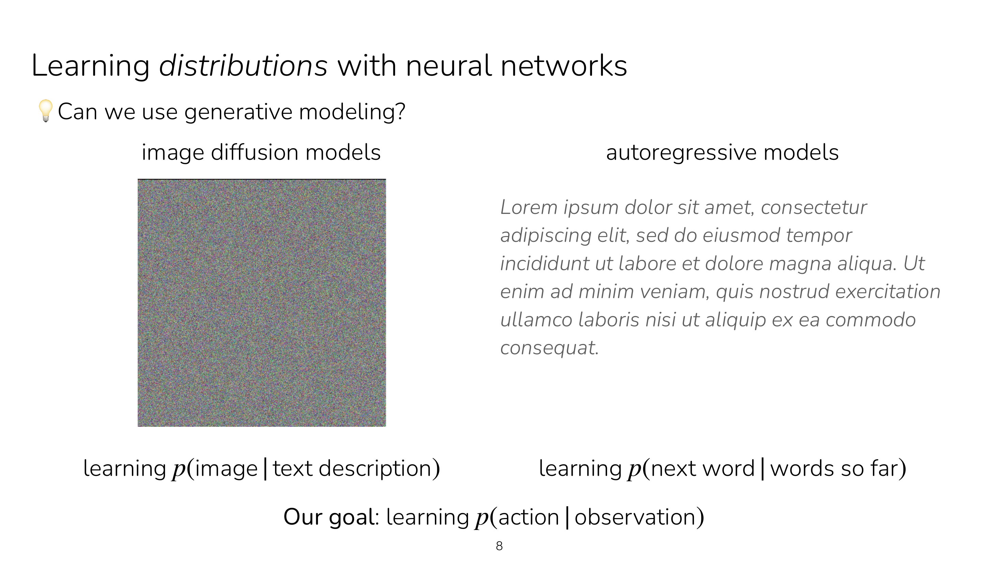

讲义把类比摆得很直白：图像扩散模型学的是 `p(图像 | 文本)`，自回归语言模型学的是
`p(下一个词 | 已有的词)`，**我们要学的是 `p(动作 | 观察)`**——同一件事。
她在 22:53 说的是"**图像扩散模型和自回归模型背后的底层技术非常通用**"。

### 2.3 version 1：统一的训练目标

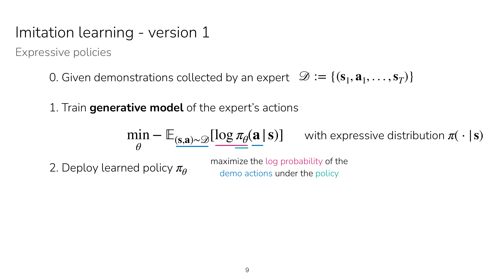

所有表达性方法的训练目标其实是同一个：

```
min_θ   E_{(s,a)~D} [ −log π_θ(a | s) ]
         └──────┬──────┘
         让专家真正做过的那个动作，在你的分布里概率尽量高
```

讲义旁注写得很清楚：**maximize the log probability of the demo actions under the policy**。

| 你选的分布类 | 这个统一目标具体变成什么 |
|---|---|
| **固定方差高斯** | **就是 L2 回归**（version 0 是 version 1 的特例） |
| 分类分布 | 交叉熵 |
| GMM | GMM 的负对数似然 |
| 离散化 + 自回归 | 逐维交叉熵之和 |
| 扩散 | 去噪损失 |

### 2.4 三种生成模型并排对比

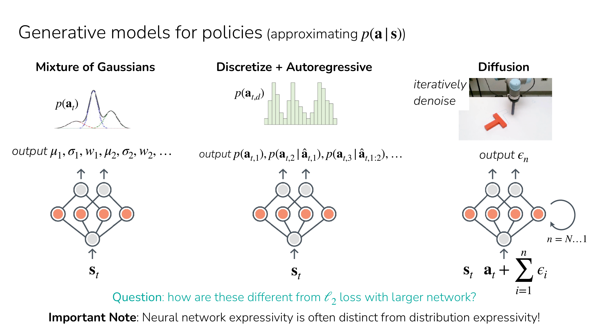

这一页是整节的总图，三列分别是 GMM、离散化+自回归、扩散，
每列标了**网络输出什么**。底部那两行是本讲最该记住的话：

> **Question: how are these different from ℓ2 loss with larger network?**
> **Important Note: Neural network expressivity is often distinct from distribution expressivity!**

下面逐个展开。

### 2.5 分类分布（16:09–17:30）

动作本来就是离散的时候最简单。比如动作只有 `{左转, 直行, 右转}`，
网络输出 3 个 logits 过 softmax：

```
P(左转) = 0.45
P(直行) = 0.50
P(右转) = 0.05
```

**它天然能表示多峰**——这就是个双峰分布（0.45 和 0.50 两根高柱，中间 0.05 是谷）。
采样时按概率抽一个，45% 左转、50% 直行，**绝不会输出"介于左转和直行之间"的东西**。

> 关键在于：**离散分布没有"平均"这个操作。** 你不能对"左转"和"直行"求平均。
> 多峰的病在这里被结构性地堵死了。这就是讲义说它 "maximally expressive" 的原因。

**局限**（17:03）：真实动作通常是**连续**且**多维**的，直接离散化成一张大表会爆炸。

### 2.6 高斯为什么不够（17:47）

网络输出 `μ(s)` 和 `σ(s)`。这比确定性策略好一点——至少能表达"我不确定"。
但高斯**只有一个峰**，面对 0 和 −2 两个模式，它只能二选一：

- 把 `μ` 放在 −1、`σ` 撑得很大 → "我在 −2 到 0 之间随便选"，**采样出来经常还是 −1，照样压线**
- 把 `μ` 放在 0 或 −2 → 直接丢掉另一个模式

她在 18:09 说的"为了覆盖更大的概率质量而把方差撑大"，就是第一种情况——
**这是高斯在多峰数据上必然的妥协。**

### 2.7 高斯混合模型 GMM（23:16–25:50）

思路：一个高斯不够，那就用 n 个。网络输出 **n 组**参数：

```
        ┌─▶ (μ₁, σ₁, w₁)
  s ──▶ ├─▶ (μ₂, σ₂, w₂)       w 是混合权重，w₁+w₂+...+wₙ = 1
        └─▶ (μ₃, σ₃, w₃)

p(a|s) = w₁·高斯(a; μ₁,σ₁²) + w₂·高斯(a; μ₂,σ₂²) + ... + wₙ·高斯(a; μₙ,σₙ²)
```

代进开车的例子，n = 2 就够：

```
  w₁=0.5, μ₁=-2, σ₁=0.3     w₂=0.5, μ₂=0, σ₂=0.3
            ╱╲                        ╱╲
           ╱  ╲                      ╱  ╲
  ────────╱────╲────────────────────╱────╲────────▶
         -2                         0
```

**采样分两步**：先按权重 `w` 抽一个分量（50% 抽到第 1 个），再从那个高斯里采样。
所以结果要么在 −2 附近，要么在 0 附近，**永远不会在 −1**。

**局限**（24:46）：**表达能力上限由 n 决定**，而 n 是得提前猜的超参数。
高维动作空间里，用少量各向同性高斯去拼复杂形状，效率也很低。

### 2.8 ★ 离散化 + 自回归（25:50–44:12）—— 最长也最绕的一段

> 这一段在 2026 讲义上只有 Slide 10 中间那一列，细节全在 2025 的白板上（14:50 她说
> "我们来开一个新的白板吧"）。所以下面主要按录播整理。

#### (a) 要解决的新问题：维度之间的耦合

前面都假装动作是一维的（只有转向）。真实动作是**多维**的，比如 `a = (转向, 加速度)`。
她在 29:37 举的就是这个：向左并线时，不仅转向不同，**加速度也不同**。

假设真实的专家行为只有两种模式：

| 模式 | 转向 | 加速度 |
|---|---|---|
| A：直行巡航 | `0` | `0`（保持） |
| B：左并线 | `−2` | `+1`（加速切入） |

**如果对每一维各用一个独立的分类分布会怎样？**

```
P(转向)：   −2 的概率 0.5，  0 的概率 0.5     ✓ 单看这一维是对的
P(加速度)：  0 的概率 0.5， +1 的概率 0.5     ✓ 单看这一维也是对的

但采样时两维各抽各的，就有四种结果：
  (−2, +1)  ← 模式 B          概率 0.25   ✓
  ( 0,  0)  ← 模式 A          概率 0.25   ✓
  (−2,  0)  ← 打方向但不加速   概率 0.25   ✗ 数据里不存在！
  ( 0, +1)  ← 直行猛加速       概率 0.25   ✗ 数据里不存在！
```

**一半的采样结果是数据里从没出现过的动作。**

这是多峰问题在多维空间的翻版——只是这次毁掉它的不是"取平均"，而是"**假设各维独立**"。
两个毛病本质相同：**分布类表达力不够，于是把概率质量洒到了数据不在的地方。**

#### (b) 那就建模完整联合分布？会爆炸（35:11–36:21）

正确做法当然是建模联合分布 `P(转向, 加速度)`，这样 `(−2, 0)` 的概率就是 0。
但假设每维离散成 **K = 100** 个 bin、动作 **D** 维，组合数是 `K^D`：

| 动作维度 D | 需要的 bin 组合数 |
|---|---|
| 2（转向、加速） | 100² = 10 000 |
| 3 | 100³ = 1 000 000 |
| **7（机械臂）** | **100⁷ = 10¹⁴** |

**输出层要有 10¹⁴ 个神经元。** 这就是她说的"离散化动作的维度会爆炸式增长"。不可行。

#### (c) 自回归：用链式法则把爆炸拆开

概率论的**链式法则**（两维版最清楚）：

```
P(a¹, a²) = P(a¹) × P(a² | a¹)
```

D 维版：

```
P(a¹,a²,...,a^D) = P(a¹) · P(a²|a¹) · P(a³|a¹,a²) · ... · P(a^D | a¹,...,a^{D−1})
```

**这是恒等式，没有任何近似。** 它把一个 `K^D` 大小的表拆成 D 个 `K` 大小的小表。
讲义 Slide 10 中间那行写的 `p(a_{t,1}), p(a_{t,2}|â_{t,1}), p(a_{t,3}|â_{t,1:2}), …`
就是这个。

采样过程：

```
第 1 步：     s      ──▶ [网络] ──▶ P(转向)              ──采样──▶  转向 = −2
                                                                      │
                                                                      ▼ 喂回去
第 2 步：  (s, −2)   ──▶ [网络] ──▶ P(加速度 | 转向=−2)  ──采样──▶  加速度 = +1
```

**关键在第二步的那个条件。** 网络看到"转向 = −2"，就知道这是在并线，
于是输出的加速度分布会把几乎全部概率压在 +1 上：

```
P(加速度 = +1 | 转向 = −2) ≈ 1.0
P(加速度 =  0 | 转向 = −2) ≈ 0.0      ← 坏组合被堵死了
```

代价对比：

| 方案 | 输出规模 | 能表示完整联合分布吗 |
|---|---|---|
| 各维独立 | `D × K` = 200 | ❌ |
| 完整联合表 | `K^D` = 10¹⁴ | ✅ 但不可行 |
| **自回归** | **`D × K` = 200（但要分 D 次前向）** | **✅** |

**用"多跑几次前向传播"换掉了"指数级的输出层"。这就是自回归的全部价值。**

#### (d) 训练怎么做（32:17–33:20, 40:28–41:10）

训练比采样简单，因为**真实动作你全都知道**，不需要一步步采。
对一条数据 `(s, a¹=−2, a²=+1)`：

```
输入 (s)          → 网络 → P(a¹)       → 交叉熵损失，目标是 bin(−2)
输入 (s, a¹=−2)   → 网络 → P(a² | a¹)  → 交叉熵损失，目标是 bin(+1)
                          ↑
                  这里喂的是真实的 −2，不是网络自己预测的那个
```

这个"训练时喂真值"的做法叫 **teacher forcing**（40:47）。
两处和语言模型一模一样：骨干网络通常用 **Transformer**（32:47），损失是**交叉熵**（32:17）。

她在 33:41 提了一个很好的不同点：句子里的词有天然顺序，
但**机械臂的 7 个关节没有天然顺序**，你得人为规定一个。
理论上表达能力不随顺序改变，但实践中这是个困扰。

#### (e) 离散化本身的细节（27:46–29:15, 41:10–42:25）

- **怎么离散**：把连续区间切成若干 bin，分布变成**阶梯状的直方图**（Slide 10 中间那张图）
- **粒度权衡**（29:15）：bin 太粗 → 动作精度不够（机器人会抖）；bin 太细 → 每个 bin 数据太少，难学
- **标签平滑**（42:05）：把 one-hot 目标抹平一点，让相邻 bin 也分到概率

### 2.9 扩散 / 流匹配（录播 44:12–45:10 一笔带过；2026 讲义展开成 4 页）

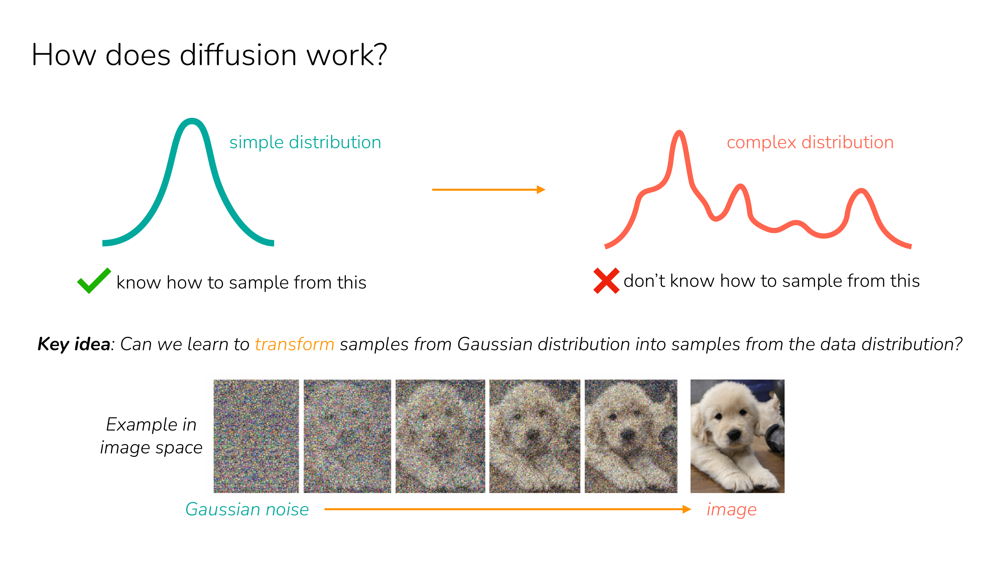

核心思想：**学一个变换，把容易采样的简单分布（高斯噪声）的样本，变成数据分布的样本。**

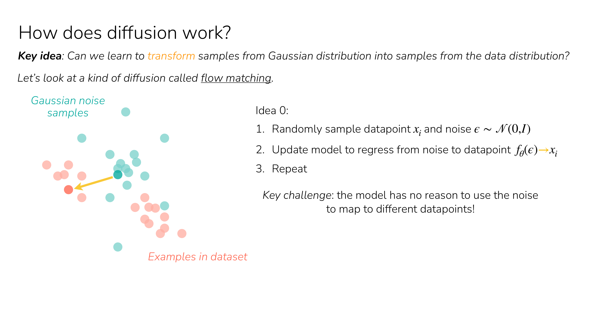

讲义先给了一个**失败的朴素想法（Idea 0）**：随机取一个数据点 `xᵢ` 和一个噪声 `ε`，
训练模型做 `f_θ(ε) → xᵢ` 的回归。**问题是：模型没有任何理由去利用噪声把不同的
噪声映射到不同的数据点**——它会再次坍塌成平均值。（注意这就是 L2 回归那个病的翻版。）

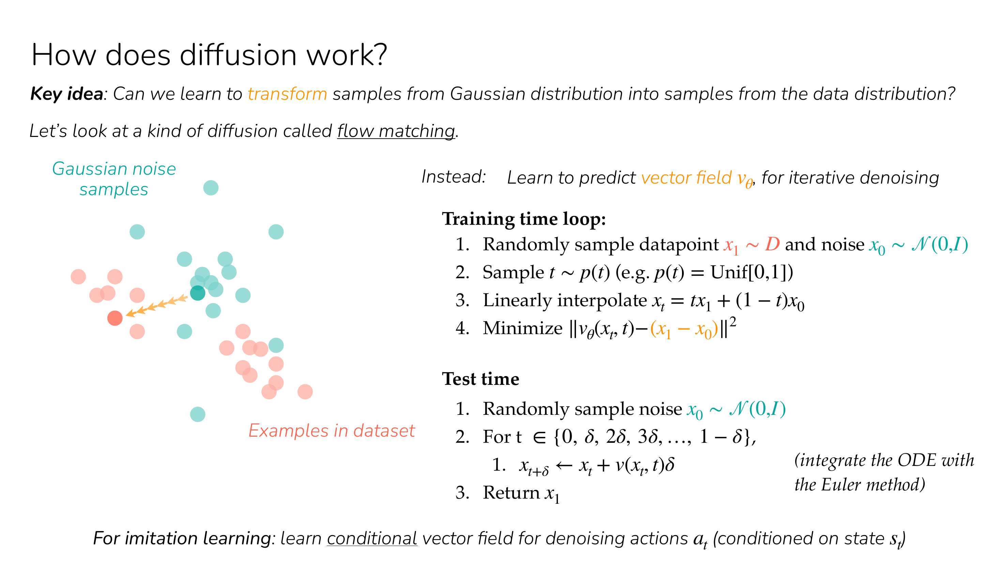

正确做法是学一个**向量场 `v_θ`**，用于迭代去噪。讲义给了完整的训练/推理伪代码：

```
训练：
  1. 随机取数据点 x₁ ~ D，噪声 x₀ ~ N(0, I)
  2. 随机取时间 t ~ Unif[0,1]
  3. 线性插值：x_t = t·x₁ + (1−t)·x₀
  4. 最小化 ‖ v_θ(x_t, t) − (x₁ − x₀) ‖²          ← 学"从噪声指向数据的方向"

推理：
  1. 采噪声 x₀ ~ N(0, I)
  2. 对 t = 0, δ, 2δ, ..., 1−δ：
         x_{t+δ} ← x_t + v(x_t, t)·δ              ← 用欧拉法积分这个 ODE
  3. 返回 x₁
```

用于模仿学习时，就是**学一个以状态 sₜ 为条件的向量场，对动作 aₜ 去噪**。

和自回归对照着记（她在 44:48 也是这么说的）：**两者都是迭代过程**，区别是迭代的方向——

| | 沿什么迭代 | 生成一个动作要跑几次网络 |
|---|---|---|
| 自回归 | 沿**动作维度**（先转向，再加速度） | D 次 |
| 扩散 | 沿**去噪步数** | 几十到上百次 |

> **两版差异**：2025 录播对扩散只讲了一分钟（"从纯噪声开始迭代去噪"），
> 2026 讲义用 Slide 11–14 完整讲了 **flow matching**，含训练/推理伪代码。
> 想搞懂扩散策略的话，看讲义这 4 页比看录播有用得多。

### 2.10 ★★ 这一段的落点：网络表达能力 ≠ 分布表达能力（45:10–47:30）

这是整个 30 分钟的**结论**，也是最容易被略过的地方，讲义在 Slide 10 底部专门加粗了。

```
   状态 s ──▶ ┌─────────────┐ ──▶ 参数 λ ──▶ ┌──────────┐ ──▶ 动作 a
              │  神经网络    │                │  分布类   │
              └─────────────┘                └──────────┘
                     ▲                              ▲
                     │                              │
            【网络的表达能力】              【分布的表达能力】
         能表示多少种 s→λ 的映射         这些参数能表示多少种分布
            由网络大小/架构决定             由你选的分布类决定
```

她的原话（46:58–47:05）：

> 如果它只输出均值和方差，它可以**非常好地**表示"状态→均值方差"这个函数，
> **但它无法表示任何比高斯更复杂的东西**。

| 想解决的问题 | 该动哪里 |
|---|---|
| 策略在复杂场景下反应不对、泛化差 | **加大网络**（左边） |
| 策略在多峰数据上输出"平均动作" | **换分布类**（右边），加大网络**完全没用** |

45:34–46:07 她明确说了：**更大的网络比小网络更有表达力，但这并不改变它表示更复杂
分布的能力。** 这正是 Slide 10 那句 "how are these different from ℓ2 loss with
larger network?" 的答案。

### 2.11 实验验证（48:19–51:28 / Slide 15）

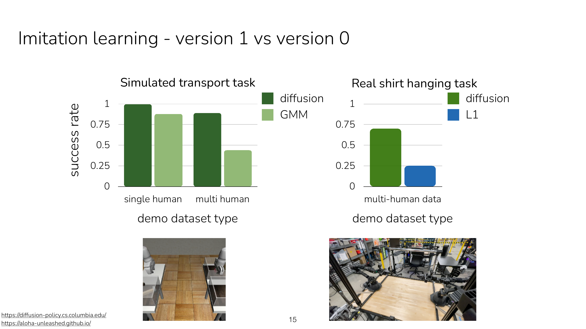

两个任务：模拟的 transport 任务、真实的挂衬衫任务。结论和理论预测一致：

- **单人演示数据**：扩散和 GMM 差距不大（数据本来就接近单峰）
- **多人演示数据**：**扩散明显胜出**，GMM 掉得很厉害

也就是她在 49:17 说的：**数据越多样，分布的表达能力越重要。**
右图是扩散损失 vs L1 损失的对比，同样的结论。

### 2.12 工业界在用什么（Slide 16–17）

讲义列了一串真实系统，可以当作"这节课不是纸上谈兵"的佐证：

| 系统 | 用的方法 |
|---|---|
| Physical Intelligence π0.6 / NVIDIA Gr00t / Figure Helix | **扩散** |
| OpenVLA | **离散化 + 自回归** |
| Waymo EMMA / Wayve LINGO-2 | **离散化 + 自回归** |

### 2.13 ☆ Action Chunking（仅 2026 讲义有，录播没讲）

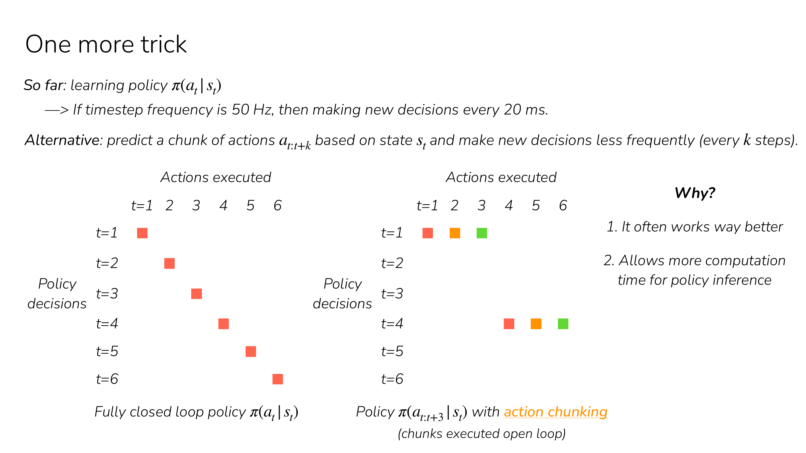

一个很实用的技巧，2025 录播里完全没有：

- 目前为止策略都是 `π(aₜ | sₜ)`——50 Hz 就意味着**每 20 毫秒重新决策一次**
- 替代方案：**一次预测一整段动作** `π(a_{t:t+k} | sₜ)`，然后**开环执行这 k 步**，
  每 k 步才重新决策一次

讲义给的两条理由很直白：

1. **它往往效果好得多**
2. **给策略推理留出了更多计算时间**

> 这和 L1 讲的"20 Hz 带来长时域问题"是同一个张力的两种应对：
> 分层 RL 是在语义层面分层，action chunking 是在时间尺度上粗化。
> Slide 19 给了参考文献（ALOHA、Diffusion Policy，以及几篇分析文章）。

### 2.14 第一部分小结

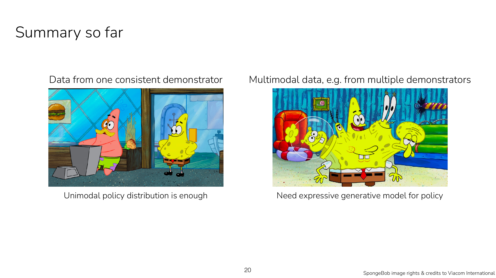

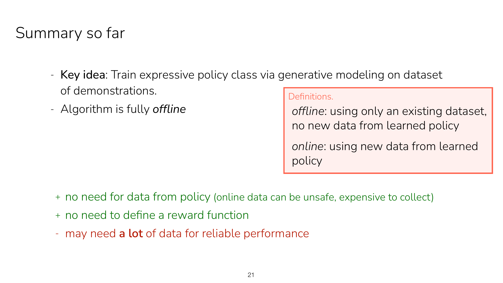

Slide 20 把判据总结成一句话：

- **数据来自一个一致的演示者** → **单峰策略分布就够了**
- **多峰数据（例如多人采集）** → **需要表达性生成模型**

Slide 21 则是算法层面的总结，并顺带给出了整门课都要用的**离线 / 在线定义**：

```
离线 (offline)：只用已有数据集，不从学到的策略采新数据
在线 (online) ：要用当前学到的策略去真实环境里采新数据
```

**行为克隆是完全离线的**（51:48），这带来两个优点和一个缺点：

- ✅ **不需要策略数据**——在线数据可能**不安全、也很贵**（52:41 她说"你可能不想让一个
  还没练好的策略去采数据"）
- ✅ **不需要定义奖励函数**（53:04）——开车不用把"你该怎么开"全写成公式
- ❌ **可能需要大量数据**才能有可靠性能（53:25）

---

## 三、第二个毛病：复合误差与协变量偏移（55:00–1:06:56 / Slide 23–26）

### 3.1 问题本身

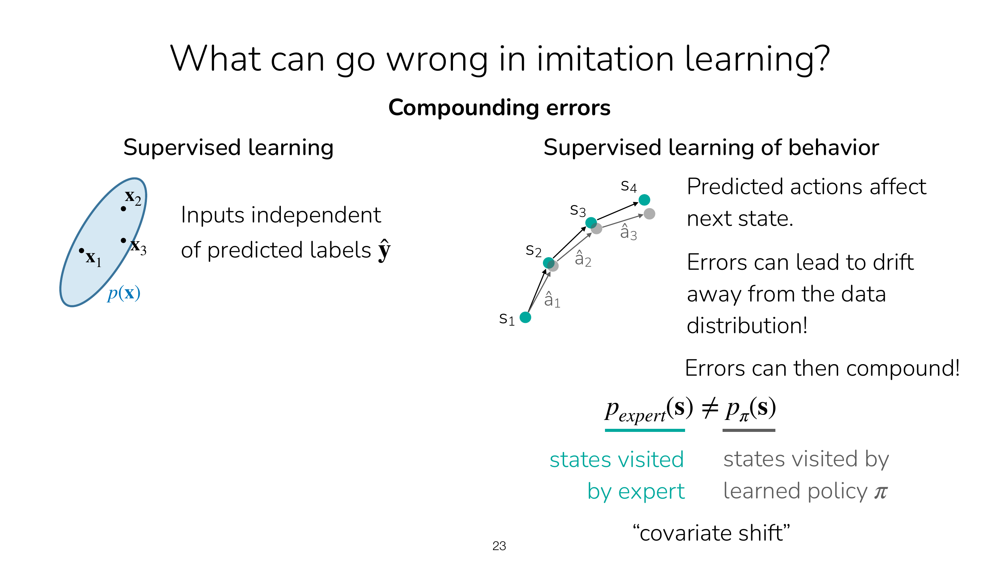

讲义左右并排，对比得非常清楚：

| | 监督学习 | 行为的监督学习（模仿学习） |
|---|---|---|
| 输入从哪来 | 固定数据集，**输入与模型预测相互独立** | **预测的动作会影响下一个状态** |
| 犯错的后果 | 就是这一个样本错了 | **漂移出数据分布，然后错误不断累加** |

她的讲法（55:00 起）：你 rollout 策略，**犯一点小错 → 进入演示没覆盖的区域 →
在那里更容易犯错 → 偏得更远**（56:38）。这叫 **复合误差 / compounding error**（56:52）。

根本原因讲义写成一行公式：

```
p_expert(s)  ≠  p_π(s)
专家访问过的状态分布 ≠ 习得策略访问的状态分布
```

这叫 **协变量偏移 / covariate shift**（57:44）。

> 这正好回到 L1 讲的那句话：**RL 的数据不是 i.i.d. 的，动作会影响未来的观察。**
> 协变量偏移就是那句话的具体后果。

### 3.2 两条解法

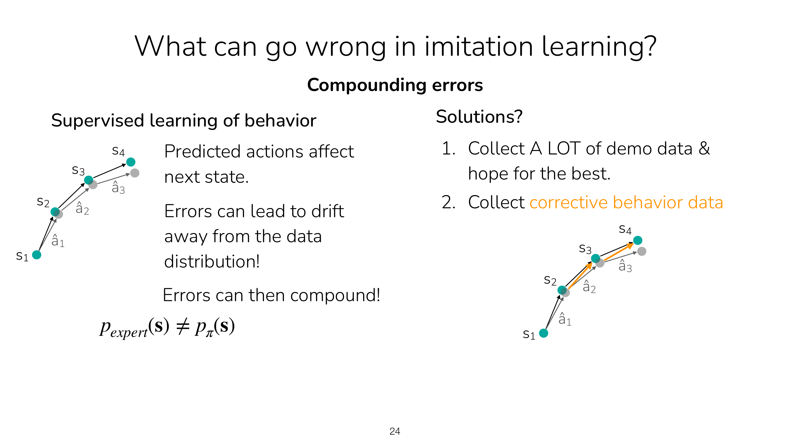

讲义列了两条：

1. **收集海量演示数据，然后祈祷**（"collect A LOT of demo data & hope for the best"）
2. **收集纠正性行为数据** ← 真正的解法

### 3.3 DAgger（58:38–1:02:29 / Slide 25）

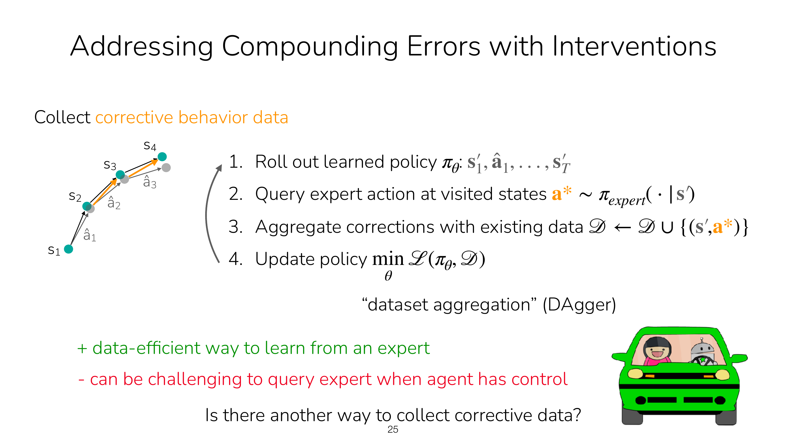

思路：在策略会犯错的地方，告诉它"在这里你应该这么做"。算法循环（讲义四步）：

```
1. rollout 当前策略 π_θ，得到 s'₁, â₁, ..., s'_T          ← 图上蓝色轨迹
2. 在访问过的状态上查询专家动作  a* ~ π_expert(· | s')     ← 图上绿色
3. 把纠正数据聚合进已有数据集    D ← D ∪ {(s', a*)}
4. 在聚合后的数据集上更新策略    min_θ L(π_θ, D)
5. 重复（新策略会有新的失败模式，再采新的纠正数据）
```

本质上是**把数据分布从"专家访问的状态"扩展到"我的策略会访问的状态"**（1:00:30）。
更新时可以在原数据集上热启动再微调，也可以从头训（1:01:34）。

名字来自 **Dataset Aggregation**。她吐槽这名字"**很糟糕，缺乏描述性**"（1:02:12）。

讲义的一正一负：

- ✅ **从专家学习的数据高效方式**
- ❌ **当智能体在控制时，查询专家可能很困难**

**这个缺点是致命的**（1:02:29）：给你一张车在路上的照片，让你说出精确的转向角度——
人其实答不好。讲义底部直接抛出了下一页的问题：
**"Is there another way to collect corrective data?"**

### 3.4 HG-DAgger：让专家直接接管（1:02:29–1:05:56 / Slide 26）

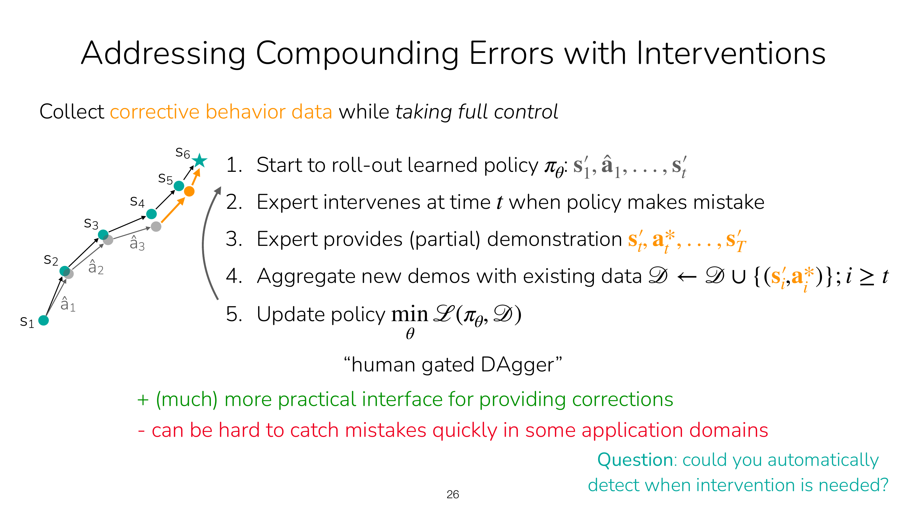

既然逐状态标注动作太难，那就换个人机接口：**让专家在策略出错时直接接管**（1:03:41）。

```
1. 开始 rollout 策略 π_θ
2. 专家在时刻 t 发现策略犯错，介入
3. 专家提供一段（部分）演示 s'_t, a*_t, ..., s'_T
4. 把这些新演示聚合进数据集  D ← D ∪ {(s'ᵢ, a*ᵢ)}, i ≥ t
5. 更新策略，重复
```

叫 **human gated DAgger**。讲义的一正一负：

- ✅ **提供纠正的接口实用得多**
- ❌ **在某些领域很难及时发现错误**

她补充的两个限制：

- **策略性能上限永远是专家**（1:04:50）
- **"什么时候算出错"是主观的**（1:04:55），而且**你得在撞上之前就接管**，
  但策略可能突然做出无法预测的动作，**来不及预防**（1:05:16）

她指出这就是**自动驾驶公司安全驾驶员的做法**（1:05:40），
并坦承"**我们也见过安全驾驶员没能阻止严重事故的案例**"。

讲义角落还留了一个开放问题：**能否自动检测何时需要介入？**

### 3.5 一个重要的实践细节：纠正数据的多样性（1:06:23）

学生问：为什么纠正数据太窄会导致过拟合？她的回答很具体：

> 原始驾驶数据遍布全美，而纠正数据只来自斯坦福校园。合并训练后，
> 模型可能只学到校园场景下的纠正行为，并过拟合到斯坦福，泛化变差。

**纠正数据的场景多样性要跟原数据集匹配。**

---

## 四、怎么收集演示（Slide 28–29，录播因时间没讲）

> 2025 录播到 1:06:56 就结束了，这部分讲义有、课上没讲。

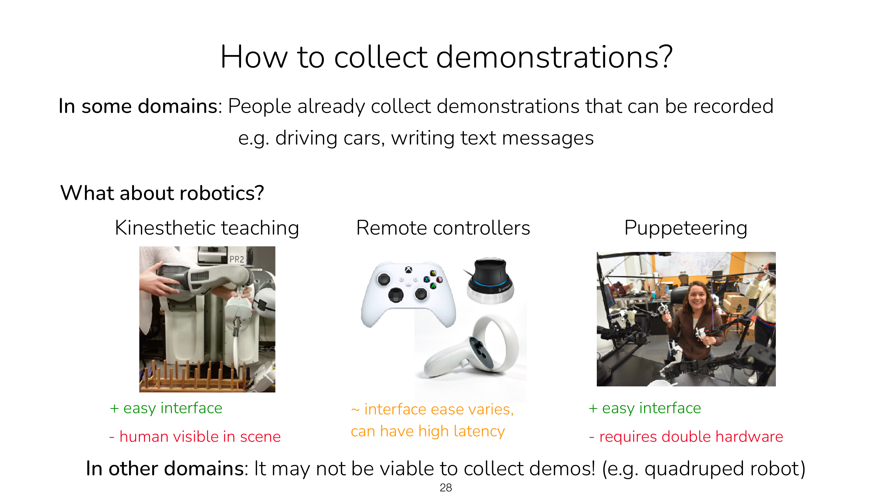

- **有些领域人类本来就在产生可记录的演示**：开车、写短信
- **机器人领域的三种接口**：

| 接口 | 优点 | 缺点 |
|---|---|---|
| 动觉示教（手把手拖动） | 接口简单 | 人会出现在画面里 |
| 遥控器 | 易用性视情况而定 | 可能延迟很高 |
| 主从操控（puppeteering） | 接口简单 | 需要双份硬件 |

- **有些领域根本采不到演示**（例如四足机器人）

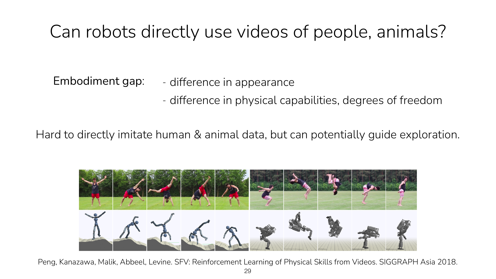

**能不能直接用人和动物的视频？** 障碍是 **embodiment gap（形态差异）**：

- 外观不同
- **物理能力和自由度不同**

结论：**难以直接模仿人类/动物数据，但可以用来引导探索。**

---

## 五、全讲总结（Slide 30）

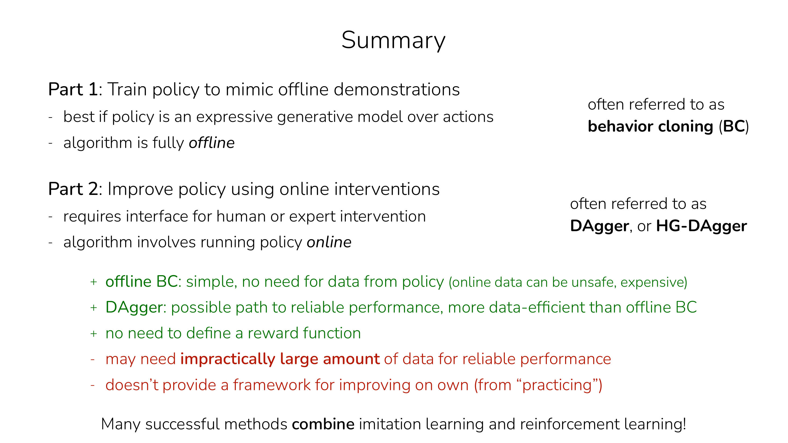

```
Part 1：训练策略去模仿离线演示             → 通常叫 行为克隆 (BC)
   - 策略最好是一个对动作的表达性生成模型
   - 算法完全离线

Part 2：用在线介入改进策略                 → 通常叫 DAgger / HG-DAgger
   - 需要人类或专家介入的接口
   - 算法涉及在线运行策略

+ 离线 BC：简单，不需要策略数据（在线数据可能不安全、很贵）
+ DAgger：通向可靠性能的一条路，比离线 BC 更数据高效
+ 都不需要定义奖励函数
− 可能需要大到不现实的数据量才能可靠
− 没有提供一个「靠自己练习来提升」的框架      ← 这是通往 RL 的那道门
```

最后一行是整讲的落点，也是下一讲的引子：

> **Many successful methods combine imitation learning and reinforcement learning!**

Slide 32 写明下次开始讲**强化学习算法**。

---

## 时间戳导航（备查）

| 时间 | 内容 | 对应讲义 | 重要度 |
|---|---|---|---|
| 00:00–02:30 | 回顾 L1 符号 + 今天的计划 | Slide 3, 5 | — |
| 02:30–07:25 | 模仿学习目标 + 行为克隆 version 0 | Slide 4 | ⭐⭐ |
| **07:25–14:34** | **多峰性问题** | Slide 6 | ⭐⭐⭐ |
| **14:34–16:09** | **核心抽象：网络输出分布的参数** | Slide 7 | ⭐⭐⭐ |
| 16:09–23:16 | 分类分布、高斯及其局限 | Slide 7 | ⭐⭐ |
| 23:16–25:50 | 高斯混合模型 GMM | Slide 10 | ⭐⭐ |
| 25:50–44:12 | 离散化 + 自回归（白板，讲义没有） | Slide 10 | ⭐⭐ |
| 44:12–45:10 | 扩散（讲义展开成 Slide 11–14） | Slide 11–14 | ⭐ |
| **45:10–47:30** | **网络表达能力 ≠ 分布表达能力** | Slide 10 底部 | ⭐⭐⭐ |
| 47:30–48:19 | 统一目标：负对数似然 | Slide 9 | ⭐⭐ |
| 48:19–51:28 | 实验：扩散 vs GMM vs L1 | Slide 15 | ⭐ |
| 51:28–51:48 | 小结 | Slide 20–21 | — |
| **51:48–53:30** | **离线 vs 在线** | Slide 21 | ⭐⭐⭐ |
| 53:30–55:00 | 学生问：IL 的研究在研究什么 | Slide 16–17 | ⭐ |
| **55:00–58:38** | **复合误差与协变量偏移** | Slide 23 | ⭐⭐⭐ |
| **58:38–1:02:29** | **DAgger** | Slide 25 | ⭐⭐⭐ |
| 1:02:29–1:05:56 | HG-DAgger | Slide 26 | ⭐⭐ |
| 1:05:56–1:06:56 | 安全驾驶员失效 + 过拟合问答 | — | ⭐ |
| （录播未讲） | 怎么收集演示、形态差异 | Slide 28–29 | ⭐ |
| （录播未讲） | Action chunking | Slide 18–19 | ⭐⭐ |

---

## 一句话

> **模仿学习的第一个坑不在于"学"，而在于"你允许策略表示什么样的分布"；
> 第二个坑不在于"学得准不准"，而在于"你的策略会走到哪些你没数据的地方"。**
